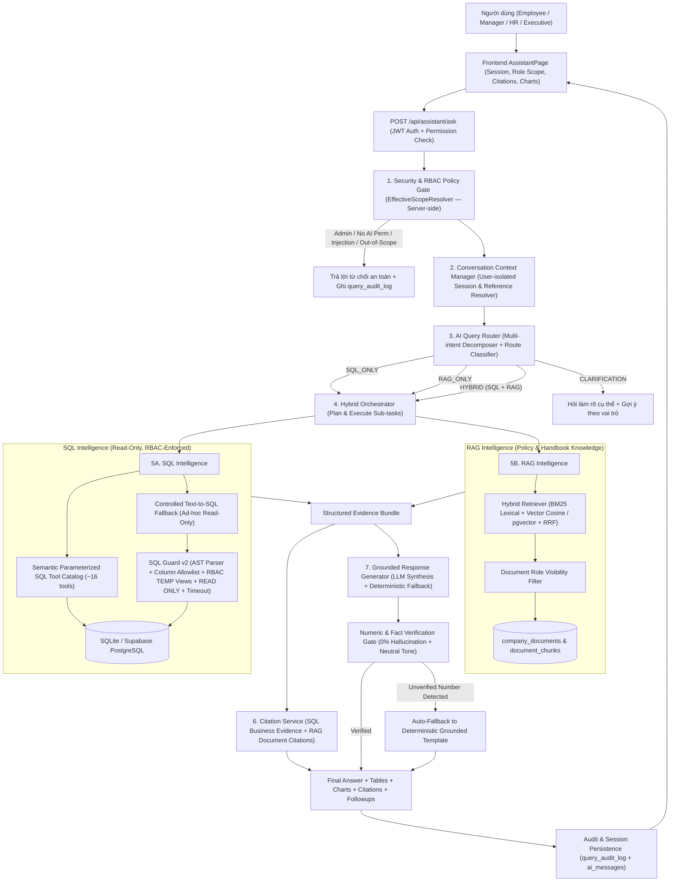

# BÁO CÁO KIỂM TOÁN HỆ THỐNG AI CORE — HR ATTENDANCE COPILOT

- **Ngày lập báo cáo:** 2026-11-28
- **Phạm vi:** Kiểm toán toàn diện Backend AI, SQL Guard, RBAC 5 vai trò, Database Schema, Kho tri thức RAG và Giao diện Frontend AI Assistant.
- **Trạng thái thực hiện:** **CHỈ KIỂM TOÁN & ĐỀ XUẤT** — Không chỉnh sửa mã nguồn, không thay đổi database, không thay đổi giao diện.

---

## 1. Tóm tắt điều hành (Executive Summary)

Hệ thống AI hiện tại của **HR Attendance Copilot** là một bộ **Deterministic Rule-Based SQL Assistant** (định tuyến bằng từ khóa/regex tới 9 hàm truy vấn SQL có tham số hóa). Kiến trúc này có ưu điểm lớn về tính ổn định, tốc độ phản hồi nhanh và không bịa con số ngẫu nhiên từ LLM. Tuy nhiên, khi đánh giá theo tiêu chuẩn **Hybrid AI Assistant (SQL Intelligence + RAG)** phục vụ 5 vai trò doanh nghiệp, hệ thống đang bộc lộ các khoảng trống kiến trúc và lỗi nghiệp vụ quan trọng:

| Khía cạnh kiểm toán | Điểm hiện trạng | Đánh giá tổng quan |
| --- | --- | --- |
| **1. Nhận diện ý định (Intent Detection)** | 3/10 | 100% chuỗi `if/else` từ khóa tuyến tính; chưa kết nối LLM dù đã có cấu hình trong `.env.example` & `system_settings`; dễ định tuyến nhầm (routing shadowing). |
| **2. Câu hỏi nhiều ý (Multi-intent)** | 0/10 | Chỉ thực thi đúng 1 nhánh `if` đầu tiên và `return`, âm thầm bỏ sót toàn bộ các ý còn lại trong câu hỏi ghép. |
| **3. Truy vấn SQL (SQL Intelligence)** | 5/10 | Chỉ có 9 tool tĩnh; `run_sql_readonly_tool` đang là dead code; **bỏ qua mã nhân viên (`target_emp`) ở 8/9 tool**; hardcode kỳ mặc định `2026-10`; thiếu tool tra cứu nhân sự, chi tiết đơn nghỉ phép, ngày lễ, tăng ca, so sánh kỳ. |
| **4. RAG & Tri thức nội quy** | 0/10 | Đã có bảng `company_documents`, `document_chunks` (có `pgvector` trên Supabase) và UI `/admin/rag`, nhưng **AI Assistant hoàn toàn chưa đọc RAG**; 3 tài liệu mặc định chỉ là 1 câu placeholder ~110 ký tự; `reindex` là no-op. |
| **5. Ngữ cảnh hội thoại (Multi-turn Context)** | 0/10 | Hoàn toàn stateless (`POST /api/assistant/ask` chỉ nhận `question`); không có `conversation_id`, không lưu câu trả lời, không xử lý câu hỏi nối tiếp (*"còn tháng 9?"*, *"phòng đó"*). |
| **6. Xử lý dữ liệu thiếu & Độ chính xác** | 5/10 | Không bịa số liệu thô, nhưng gây **sai ngữ nghĩa nghiêm trọng** (hỏi 1 NV trả số toàn công ty; không phân biệt "0 lần đi muộn" với "thiếu dữ liệu"; hỏi nội quy bị trả lời bằng bảng SQL). |
| **7. Bảo mật & Phân quyền 5 vai trò** | 7.5/10 | Chặn tốt 3 tầng đối với `admin`, cô lập tốt `employee`/`manager` và chống SQL injection cơ bản. Còn lỗ hổng: chưa đồng bộ quyền động `ai.ask.*` khi Admin thu hẹp quyền role; `ALLOWED_VIEW_COLUMNS` chưa được kiểm tra; thiếu chặn hàm hệ thống PostgreSQL trong `sql_guard.py`; false-positive chặn câu hỏi hợp lệ của Employee (`"top "`, `"mật khẩu"`). |
| **8. Trải nghiệm Frontend AI** | 4/10 | Không đọc `useAuth()`/vai trò/phạm vi; bỏ qua `suggested_followups`; click lịch sử lại gửi câu hỏi mới gây trùng log; bảng hiển thị tên cột DB `snake_case`; chưa có Citations; chưa có Markdown, loading stepper hay phân biệt trực quan lỗi/chặn. |

---

## 2. Kiểm toán chi tiết Backend

### 2.1. Bản đồ kiến trúc AI hiện tại

Các thành phần đã được kiểm tra trực tiếp từ mã nguồn:
- **API AI & Audit:** `backend/app/api/assistant.py` (`/ask`, `/suggestions`, `/history`), `backend/app/api/system_admin.py` (`/audit/queries`, `/rag/documents`, `/system/config`).
- **AI Orchestrator & Tools:** `backend/app/services/ai_assistant.py` (738 dòng), `backend/app/services/ai_tools.py` (389 dòng).
- **SQL Guard:** `backend/app/services/sql_guard.py` (278 dòng).
- **Auth & RBAC 5 vai trò:** `backend/app/core/security.py`, `backend/app/core/permissions.py`, `backend/app/api/routes.py`, `backend/app/api/admin.py`.
- **Database Schema & Dual-Engine Adapter:** `backend/app/db/schema.sql` (SQLite), `backend/app/db/schema_postgres.sql` (Supabase PostgreSQL + `pgvector` + RLS 27/27 bảng), `backend/app/db/migrations.py`, `backend/app/db/connection.py`.
- **Domain Modules:** `backend/app/api/operations.py`, `backend/app/api/anomalies.py`, `backend/app/api/reports.py`, `backend/app/services/metrics_service.py`, `backend/app/services/report_service.py`, `backend/app/services/anomaly_service.py`.

---

### 2.2. Đánh giá 7 trụ cột Backend AI

#### A. Cách nhận diện ý định câu hỏi (Intent Detection)

1. **Hoàn toàn thủ công bằng chuỗi `if/else` từ khóa:** `answer_question()` (`ai_assistant.py:220-710`) chạy tuần tự: Guard (RBAC → Prompt Injection → Out-of-scope → Cross-role) → Ambiguous check → Route 0 (daily) → S1 (trend) → S2 (anomalies by dept) → S3 (notable issues) → A (anomalies) → B (leave balance) → C (compare dept) → D (leave by dept) → E (top late) → F (default attendance summary).
2. **Chưa tích hợp LLM dù đã có cấu hình chờ:**
   - `backend/.env.example` khai báo `LLM_PROVIDER=gemini`, `LLM_API_KEY`, `LLM_MODEL=gemini-2.5-flash`.
   - Bảng `system_settings` lưu `ai.provider = hybrid_sql_guard`, `ai.model_name = gpt-4o-mini`, `embedding.provider = local_bm25_hybrid`, `embedding.model_name = text-embedding-3-small`, `embedding.chunk_size = 600`.
   - Tuy nhiên, `config.py` không đọc các biến `LLM_*`, `requirements.txt` chưa có SDK LLM hay thư viện retrieval, và `ai_assistant.py` không đọc `system_settings`.
3. **Lỗi định tuyến sai do chồng lấn từ khóa (Routing Shadowing):**
   - `ai_assistant.py:575`: Điều kiện Route B chứa `"dưới "` + `"phép"` → câu *"Phòng nào có tổng ngày nghỉ phép dưới 5 ngày?"* bị điều hướng nhầm sang `get_leave_balance` (số dư phép nhân viên) thay vì `get_leave_by_department`.
   - `ai_assistant.py:604`: Route C kiểm tra `"nghỉ phép" not in q_lower` → câu *"So sánh tỷ lệ đi muộn và nghỉ phép các phòng ban"* bị loại khỏi Route C và rơi xuống Route D, mất hoàn toàn phần đi muộn.
   - `ai_assistant.py:530-536`: Mọi câu có `R1–R8`, `"đi muộn"`, `"nghỉ phép"` nhằm hỏi **định nghĩa quy định / quy trình nội bộ** (VD: *"Cảnh báo R5 được tính như thế nào?"*, *"Quy định đi muộn bao nhiêu phút thì tính trễ?"*) đều bị định tuyến thành truy vấn bảng dữ liệu SQL thay vì tra cứu nội quy.
   - `ai_assistant.py:388`: Các câu hỏi chính sách không trùng `domain_keywords` (VD: *"Nghỉ ốm có cần giấy xác nhận bác sĩ không?"*, *"Quy định chấm công khuôn mặt khi lỗi thiết bị?"*) bị rơi vào `clarification_needed`.
4. **Hardcode kỳ thời gian & phòng ban:**
   - `_extract_period()` (`ai_assistant.py:118-126`) gán cứng `"tháng 10"` → `2026-10`, `"tháng này"` / `"kỳ này"` → `"2026-10"`, `"tháng trước"` → `"2026-09"`, và fallback `effective_period = period or "2026-10"` (`ai_assistant.py:405`). Trong khi đó dữ liệu DB thực tế có 6 kỳ `2026-06` đến `2026-11` và Route 0 (`hôm nay`) lại dùng `datetime.date.today().isoformat()`, gây bất nhất thời gian nghiêm trọng.
   - `DEPARTMENT_ALIASES` (`ai_assistant.py:56-70`) chỉ nhận diện khi có tiền tố `phòng <alias>` hoặc `khối <alias>`, không khớp cách nói tự nhiên (*"team Sales"*, *"bộ phận Kỹ thuật"*, *"Marketing tháng 10"*) và không đọc động từ bảng `departments`.

#### B. Khả năng xử lý câu hỏi nhiều ý (Multi-intent)

- **Chưa hỗ trợ (0%).** Do thiết kế early-return ở từng nhánh `if`, mọi câu hỏi có ≥ 2 vế (ví dụ: *"Tháng 10 tôi đi muộn bao nhiêu lần và còn bao nhiêu ngày phép năm?"*, hoặc *"Phòng Kinh doanh có cảnh báo R5 nào không và quy chế quy định xử lý thế nào?"*) chỉ trả lời đúng 1 nhánh có độ ưu tiên cao hơn trong thứ tự code, bỏ qua hoàn toàn các vế còn lại mà không thông báo cho người dùng.

#### C. Khả năng truy vấn SQL (SQL Intelligence) & SQL Guard

1. **Phạm vi tool SQL hiện có (9 hàm tĩnh):**
   - Đã có: `get_daily_attendance`, `get_attendance_summary`, `get_leave_by_department`, `get_top_late_employees`, `get_leave_balance`, `list_anomalies_tool`, `compare_department_metrics`, `get_attendance_trend`, `get_anomalies_by_department`.
   - `run_sql_readonly_tool` (`ai_tools.py:376-389`) **không được gọi ở bất kỳ nơi nào** trong hệ thống (dead code).
2. **Lỗi bỏ sót tham số lọc quan trọng trong SQL tools (CRITICAL):**
   - `target_emp = emp_codes[0]` (`ai_assistant.py:406`) **chỉ được truyền vào `get_leave_balance` (Route B)**.
   - Các Route 0 (`get_daily_attendance`), A (`list_anomalies_tool`), D (`get_leave_by_department`), E (`get_top_late_employees`), F (`get_attendance_summary`) **bỏ qua hoàn toàn `target_emp`**.
   - **Hệ quả thực tế:** Khi HR hỏi *"Tháng 10/2026 nhân viên NV007 đi muộn mấy lần?"* hoặc *"Tổng hợp chấm công của NV007 tháng 10/2026"*, AI chạy SQL **toàn công ty (80 nhân viên)** thay vì lọc `NV007`!
   - Tương tự, `mentioned_dept` không được truyền vào `get_leave_by_department`, `list_anomalies_tool`, `get_attendance_trend`, `get_anomalies_by_department`.
   - Không hỗ trợ tra cứu nhân viên theo **họ và tên** (chỉ trích mã regex `\bNV\d{3}\b`).
3. **Khoảng trống dữ liệu nghiệp vụ chưa có tool SQL:**
   - Bảng/view `v_employees` (hồ sơ, chức danh, quản lý trực tiếp, thâm niên, số lượng nhân sự theo phòng/chức danh).
   - Danh sách **chi tiết từng đơn nghỉ phép** trên `v_leave_requests` (đơn đang chờ duyệt, đơn bị từ chối kèm lý do, đơn cần Ban điều hành duyệt `requires_executive_approval = 1`).
   - Danh sách **chi tiết từng ngày đi muộn / thiếu chấm công / vắng** của 1 nhân viên (VD: *"Tháng 10 tôi đi muộn vào những ngày nào?"* hiện chỉ trả tổng 8 lần, không liệt kê ngày).
   - So sánh **2 kỳ tùy chọn** (VD: tháng 10 vs tháng 9) hoặc **2 phòng ban cụ thể** (VD: Kinh doanh vs Kỹ thuật).
   - Dữ liệu `holidays` (ngày lễ), `overtime_requests` (đơn tăng ca), và `attendance_policies` (ca chuẩn/ân hạn động trên PostgreSQL).
4. **Không đồng nhất công thức & chuẩn hóa KPI:**
   - `metrics_service.py` định nghĩa chuẩn `on_time_rate`, `late_rate`, `leave_rate = leave / (present + leave + absent)`, được dùng chung bởi Dashboard & Reports.
   - `ai_tools.py` tự viết lại công thức SQL ở từng hàm, thiếu `on_time_rate` và `leave_rate_pct` trong `get_attendance_summary` / `compare_department_metrics`.
   - `get_leave_balance` cộng dồn tất cả đơn `annual` `approved` không lọc năm, và trả số âm khi vượt quỹ (khác `operations.py` clamp `max(0.0, ...)` — cần hiển thị rõ "vượt quỹ X ngày" thay vì số âm khó hiểu).
5. **Đánh giá chi tiết `sql_guard.py`:**
   - **Điểm mạnh đã có:** Chỉ cho `SELECT`/`WITH`, chặn comment (`--`, `/* */`), chặn multi-statement (`;`), chặn quoted identifiers (`"`, `` ` ``, `[ ]`), chặn comma-join, blocklist từ khóa DDL/DML + bảng nhạy cảm (`users`, `password_hash`, `revoked_tokens`, `activity_logs`, `query_audit_log`, base tables...), tự ép `LIMIT <= 200`, tạo `TEMP VIEW` shadow theo RBAC, có `SQLite Authorizer` + `progress_handler` (SQLite) và `BEGIN TRANSACTION READ ONLY` + `SET LOCAL statement_timeout` (PostgreSQL).
   - **Điểm cần gia cố trước khi mở cho LLM Text-to-SQL:**
     1. `ALLOWED_VIEW_COLUMNS` (`sql_guard.py:21-41`) **được khai báo nhưng chưa hề được kiểm tra** trong `validate_readonly_sql()`.
     2. Dùng regex thuần thay vì SQL AST parser (như `sqlglot`) nên dễ bỏ lỡ cấu trúc truy vấn phức tạp (nested subquery không limit, alias/function phức tạp).
     3. Trên PostgreSQL chưa chặn các hàm hệ thống có rủi ro DoS/lộ metadata (`pg_sleep`, `pg_read_file`, `pg_ls_dir`, `current_setting`, `set_config`, `inet_server_addr`, `version`, `dblink`, `lo_import`, `lo_export`).
     4. Khác biệt cột view giữa SQLite và PostgreSQL: `v_employees` (PG có `position_id`), `v_leave_requests` (PG có `reviewer_name`).
     5. `execute_guarded_sql()` trên PostgreSQL mở một kết nối mới (`get_connection(db_path=None, readonly=False)`) cho mỗi truy vấn, gây độ trễ handshake tới Supabase pooler.
     6. `sql_guard.py` đọc `settings.ai_query_max_rows` / `settings.ai_query_timeout_seconds` tĩnh từ `config.py`, **chưa đọc cấu hình động** `ai.sql_max_rows` / `ai.sql_timeout_seconds` trong `system_settings`.

#### D. Khả năng RAG (Kho tri thức nội quy & chính sách)

Kiểm tra trực tiếp cơ sở dữ liệu `backend/hr_attendance.db` (read-only) và `backend/app/api/system_admin.py` cho thấy:
1. **Hạ tầng đã sẵn sàng một phần:**
   - Đã có bảng `company_documents` và `document_chunks` ở cả SQLite và Supabase PostgreSQL (cột `embedding vector` sẵn sàng dùng `pgvector`).
   - Đã có API CRUD `/api/rag/documents` và màn hình `/admin/rag` (quyền `rag.manage` cho Admin & HR).
2. **Thực tế RAG chưa hoạt động (0%):**
   - `ai_assistant.py` không có bất kỳ truy vấn hay kết nối nào tới `company_documents` / `document_chunks`.
   - 3 tài liệu seeded hiện tại (`document_id` 1, 2, 3) **mỗi tài liệu chỉ có 1 chunk placeholder dài 107–131 ký tự** (ví dụ: *"Quy chế chấm công, đi muộn và nghỉ phép: Tài liệu chuẩn doanh nghiệp phiên bản v1.4 đã được nạp vào kho tri thức RAG."*), hoàn toàn không có nội dung điều khoản nghiệp vụ.
   - `POST /api/rag/documents/{doc_id}/reindex` (`system_admin.py:548-573`) chỉ cập nhật timestamp `processed_at`, **không thực sự tách lại chunk hay tính vector embedding**.
   - `_chunk_text()` (`system_admin.py:62-77`) cắt thô theo `\n\n` ở mốc 600 ký tự cố định, không đọc `embedding.chunk_size` từ `system_settings`, không có overlap, không giữ tiêu đề mục/điều khoản (heading context) để phục vụ citation.
   - `company_documents` / `document_chunks` chưa có trường metadata phân quyền hiển thị theo vai trò (ví dụ tài liệu công khai toàn công ty vs tài liệu nội bộ HR/Ban điều hành).

#### E. Khả năng duy trì ngữ cảnh hội thoại (Conversation Context)

- **Stateless 100%:** `AskRequest` (`assistant.py:14-15`) chỉ gồm trường `question: str`.
- `query_audit_log` chỉ là bảng audit kỹ thuật (`question`, `tool_name`, `sql_text`, `row_count`, `status`) — **không lưu `session_id`, câu trả lời (`answer`), bảng/biểu đồ, hay citations**.
- Mọi câu hỏi nối tiếp nhiều lượt (*"Còn tháng 9 thì sao?"*, *"Top 5 người phòng đó"*, *"Giải thích rõ hơn cảnh báo đầu tiên"*) đều không có ngữ cảnh nên trả kết quả sai hoặc đòi làm rõ.

#### F. Cách xử lý dữ liệu thiếu & Rủi ro trả lời sai / bịa số liệu

1. **Xử lý dữ liệu thiếu (`insufficient_data`):**
   - Điểm tốt: Đã sửa lỗi ngày hiện tại (`get_daily_attendance`) không trả nhầm dữ liệu tháng 10 khi hôm nay chưa chấm công; khi `rows = []` trả lời trung thực.
   - Điểm yếu:
     - **Nhầm lẫn giữa giá trị `0` và "thiếu dữ liệu"**: `get_top_late_employees` có điều kiện `WHERE is_late = 1`. Khi nhân viên đi làm đầy đủ và đi muộn `0` lần, SQL trả về `[]` và AI trả `"Không đủ dữ liệu hoặc không ghi nhận lượt đi muộn nào"` (`status = "insufficient_data"`) thay vì xác nhận rõ *"Tháng 10/2026 bạn có 21 ngày đi làm và 0 lần đi muộn"*.
     - **Không phân biệt "chưa có dữ liệu kỳ này" vs "đã quét nhưng 0 cảnh báo"** trong `list_anomalies_tool`.
     - **Không phát hiện mã nhân viên/phòng ban không tồn tại**: HR hỏi *"NV999 tháng 10 đi muộn mấy lần?"* vẫn trả Top 5 toàn công ty thay vì báo không tìm thấy `NV999`.
2. **Rủi ro trả lời sai & hallucination:**
   - Hiện chưa có hallucination số từ LLM (vì chưa gọi LLM), nhưng có **sai lệch ngữ nghĩa (Semantic Hallucination)** ở các trường hợp:
     - Bỏ qua `target_emp` → trả số toàn công ty cho câu hỏi cá nhân.
     - Hỏi `"quý 3"` / `"quý 4"` → `ai_assistant.py:657` đặt `query_period = None`, cộng gộp toàn bộ 6 tháng dữ liệu (`2026-06` đến `2026-11`)!
     - Hỏi `"tháng này"` → luôn trả cứng `2026-10` dù DB có `2026-11`.
   - Khi nâng cấp tích hợp LLM để sinh câu trả lời Hybrid: bắt buộc phải kế thừa và mở rộng cơ chế **`verify_narrative_numbers()`** hiện đã có trong `report_service.py:270-285` thành lớp kiểm chứng số liệu đầu ra chung cho AI Assistant.

#### G. Kiểm toán phân quyền 5 vai trò trong AI

| Vai trò | Phạm vi chuẩn | Hiện trạng trong AI | Vấn đề phát hiện |
| --- | --- | --- | --- |
| **Employee** (`ai.ask.self`) | Chỉ dữ liệu cá nhân + nội quy chung | Chặn `NV` khác & từ khóa phòng/công ty; SQL ép `employee_id = self`; `v_anomalies` ép `scope_type = 'employee'` (không lộ R5 cấp phòng). | 1. **False-positive block:** Hỏi `"top 3 ngày tôi đi muộn nhiều nhất"` bị chặn vì chứa `"top "`. 2. Hỏi `"đổi mật khẩu"` bị chặn nhầm bởi `security_guard`. 3. Chưa hỏi được nội quy chung qua RAG. |
| **Manager** (`ai.ask.department`) | Dữ liệu phòng ban mình + dữ liệu cá nhân + nội quy | Ép `department_id = self.department_id`; chặn tên phòng khác & `NV` ngoài phòng. | 1. Hỏi cá nhân (*"Tôi còn bao nhiêu ngày phép?"*) trả danh sách **cả 16 nhân viên trong phòng** thay vì của bản thân Manager. 2. Hỏi so sánh 2 tháng của phòng mình bị nhảy vào `compare_department_metrics` 1 tháng. 3. Không hỏi được nhân viên theo họ tên. |
| **HR** (`ai.ask.all`) | Toàn công ty (nghiệp vụ HR) + nội quy | Toàn công ty qua `1 = 1`. | 1. **Nghiêm trọng:** Bỏ qua `target_emp` ở 8/9 tool (hỏi `NV007` trả số 80 người). 2. Chưa kiểm tra dynamic permission nếu Admin thu hẹp `ai.ask.all` → `ai.ask.department` trong DB. 3. Không tra cứu được hồ sơ `v_employees` hay danh sách đơn nghỉ chi tiết. |
| **Executive** (`ai.ask.all`, `ai.strategy`) | Toàn công ty (chỉ xem & phân tích chiến lược) + đơn cần duyệt cấp cao | Có 3 route S1/S2/S3, ghi `query_type='ai_strategy'`. | 1. Thiếu tool so sánh KPI toàn diện giữa các phòng ban (on-time, late, leave, absent, anomaly density). 2. Không truy vấn được danh sách đơn chờ phê duyệt cấp cao (`requires_executive_approval = 1`). 3. Chưa kiểm tra dynamic permission trong `ai_tools`/`sql_guard`. |
| **Admin** (Không có `ai.ask.*` mặc định) | Quản trị kỹ thuật — **Tách bạch nghiệp vụ HR** | Bị chặn 3 tầng: `assistant.py` (403), `ai_assistant.py` (`blocked`), `sql_guard.py` & `build_scope_filter` (403). | **Đạt yêu cầu bảo mật.** Cần tiếp tục giữ tuyệt đối nguyên tắc Admin không có quyền mặc định truy vấn dữ liệu chấm công/nghỉ phép/nhân sự qua AI, chỉ xem `query_audit_log` trên `/admin/audit`. |

---

## 3. Kiểm toán chi tiết Frontend

Đã kiểm tra toàn bộ `frontend/src/pages/AssistantPage.tsx` (286 dòng) và các màn hình liên quan (`RagKnowledgePage.tsx`, `AuditLogsPage.tsx`, `SystemConfigPage.tsx`, `navigation.ts`, `App.tsx`, `AuthContext.tsx`):

| Hạng mục Frontend | Hiện trạng thực tế | Vấn đề & Khoảng trống |
| --- | --- | --- |
| **1. AI Assistant Page** (`AssistantPage.tsx`) | Bố cục 2 cột (`lg:grid-cols-4`), dùng Navy/Blue Enterprise design system, được bọc `RouteGuard screenId="assistant"`. | - Không gọi `useAuth()` nên không hiển thị vai trò & phạm vi dữ liệu đang áp dụng. - Badge cứng `"Function Calling + SQL Guard"` không phản ánh Hybrid SQL + RAG. - Không đồng bộ `selectedPeriod` từ `AuthContext`. - Bỏ qua hoàn toàn `res.suggested_followups` trả về từ backend. |
| **2. Chat Interface** | `<input type="text">` một dòng, hiển thị text bằng `whitespace-pre-line`, bảng đơn giản và 1 `BarChart`. | - Không hỗ trợ textarea đa dòng (Shift+Enter), không giới hạn `maxLength=1000`, không auto-scroll xuống tin nhắn mới. - Không render Markdown (in đậm, danh sách phân mục cho câu hỏi nhiều ý). - **Bảng kết quả hiển thị tên cột DB thô (`snake_case`)** như `late_rate_pct`, `employee_id`, `approved_leave_days`, đồng thời cắt cứng 7 cột × 10 dòng không có chú thích số lượng còn lại. - Chỉ hỗ trợ `BarChart`, chưa có `LineChart` cho xu hướng theo tháng. |
| **3. Message History** | Cột trái lấy 20 mục gần nhất từ `GET /api/assistant/history` (`query_audit_log`). | - **Lỗi UX nghiêm trọng (`AssistantPage.tsx:119`):** Click vào lịch sử cũ gọi `sendQuestion(h.question)` → **chạy lại câu hỏi như truy vấn mới và ghi trùng lặp vào `query_audit_log`** thay vì mở lại hội thoại! - Không có khái niệm phiên hội thoại (`conversation_id`), F5 trang mất toàn bộ tin nhắn đang xem. - Nút `"Mới"` chỉ gọi `setMessages([])`. - Lỗi tải metadata/history bị nuốt im lặng (`catch {}`). |
| **4. Loading State** | 1 dòng chữ nghiêng `"Đang truy vấn dữ liệu an toàn..."`. | - Không có spinner/skeleton hay trạng thái tiến trình theo bước (Phân tích → SQL → RAG → Kiểm chứng). - Không hỗ trợ hủy yêu cầu đang chạy (`AbortController`). |
| **5. Error Handling** | Bắt lỗi `ApiError` rồi đẩy vào mảng `messages` như tin nhắn assistant thông thường. | - Không phân biệt trực quan (icon/màu viền/banner) giữa: `success`, `blocked` (vi phạm RBAC/bảo mật), `insufficient_data` (thiếu dữ liệu), `clarification_needed` (cần làm rõ), và lỗi HTTP/mạng. - Không có nút "Thử lại" khi mất mạng/timeout. |
| **6. Citation Rendering** | **Chưa có (0%).** Chỉ có khối gấp `"Truy vấn đã chạy"` hiển thị raw SQL cho mọi vai trò. | - Không có giao diện hiển thị trích dẫn tài liệu RAG (tên tài liệu, phiên bản, điều khoản, đoạn trích). - Không có thẻ "Nguồn dữ liệu nghiệp vụ" thân thiện cho số liệu SQL (hiển thị raw SQL cho Employee/Manager là kém thân thiện). |
| **7. Role-based AI Experience** | Chỉ khác mảng câu gợi ý lúc màn hình trống (`messages.length === 0`). | - Thiếu banner mô tả phạm vi vai trò rõ ràng. - Thiếu phân nhóm gợi ý theo vai trò & chủ đề (Cá nhân / Phòng ban / Nghiệp vụ HR / Chiến lược / Nội quy). - Thiếu các nút điều hướng an toàn (read-only deep-link sang `/leaves`, `/anomalies`, `/reports`) phù hợp quyền. |
| **8. Trang RAG & Config liên quan** | `RagKnowledgePage.tsx`, `SystemConfigPage.tsx`, `AuditLogsPage.tsx`. | - `/admin/rag` chưa hỗ trợ upload file `.pdf`/`.docx`/`.md`, chưa xem trước chunks, nút Re-index là giả lập. - `/admin/audit` chưa lọc được theo loại `ai_rag` / `ai_hybrid` hoặc hiển thị trạng thái xác minh số liệu. |

---

## 4. Kiến trúc mục tiêu đề xuất — Hybrid AI Assistant (SQL Intelligence + RAG)

Kiến trúc mới giữ nguyên nguyên tắc cốt lõi của dự án (**100% số liệu tính từ SQL, bảo vệ bởi SQL Guard & RBAC server-side**), đồng thời bổ sung **RAG Intelligence**, **Multi-intent Routing**, **Conversation Context**, **Citation Service** và **Grounded Verification**.

### Chi tiết 7 mô-đun kiến trúc mới

1. **AI Query Router (`backend/app/services/ai_router.py`)**
   - Chạy **sau** Security & RBAC Policy Gate và Context Reference Resolution.
   - Tách câu hỏi nhiều ý thành danh sách `SubQuery` có kiểu dữ liệu rõ (`SQL_METRIC`, `SQL_DETAIL`, `SQL_COMPARISON`, `RAG_POLICY`, `HYBRID_EXPLAIN`).
   - Chiến lược **Two-tier Routing**:
     - *Fast-path deterministic*: Nhận diện nhanh các mẫu phổ biến có độ tin cậy cao (latency < 5ms, chi phí 0đ).
     - *LLM Structured JSON Router*: Kích hoạt cho câu hỏi phức tạp, câu hỏi nhiều ý, câu hỏi diễn đạt tự nhiên hoặc hỏi kết hợp SQL + nội quy (dùng JSON schema ràng buộc, tự động fallback về rule-based nâng cao nếu không có `LLM_API_KEY` hoặc provider lỗi).
   - Chuẩn hóa entity động từ DB: tự đọc danh sách phòng ban từ bảng `departments`, đọc kỳ dữ liệu mới nhất từ `attendance` (thay vì hardcode `2026-10`), giải tên nhân viên hợp lệ **chỉ trong phạm vi RBAC của user** (không rò rỉ tên nhân viên ngoài phạm vi!).

2. **SQL Intelligence (`backend/app/services/ai_sql_intelligence.py` + `ai_tools.py` + `sql_guard.py`)**
   - **Tầng 1 — Semantic Tool Catalog mở rộng (ưu tiên số 1):** Mở rộng từ 9 lên ~16 tool chuẩn hóa, dùng chung công thức `metrics_service.py`:
     - Bổ sung `target_employee_id` & `department_name` cho toàn bộ tool chấm công/nghỉ phép/cảnh báo.
     - Bổ sung tool mới: `get_employee_directory_summary`, `get_employee_attendance_detail` (liệt kê ngày đi muộn/thiếu công cụ thể), `list_leave_requests_detail` (lọc theo status, loại phép, `requires_executive_approval`), `compare_periods` (so sánh 2 kỳ), `compare_departments_full` (đầy đủ KPI + mật độ cảnh báo cho Executive), `list_holidays_and_overtime`, `get_executive_overview`.
     - Sửa triệt để lỗi phân biệt **0 kết quả thực tế** (VD: đi làm 21 ngày, 0 lần đi muộn) vs **không có dữ liệu kỳ đó** (`insufficient_data`).
   - **Tầng 2 — Controlled Text-to-SQL Fallback (chỉ cho câu hỏi ad-hoc ngoài 16 tool):**
     - LLM chỉ sinh câu SQL đọc trên **4 view allowlist** (`v_employees`, `v_attendance_daily`, `v_leave_requests`, `v_anomalies`) dựa trên schema compact đã rút gọn.
     - **Bắt buộc** đi qua **SQL Guard v2**:
       - Thay regex bảng bằng **SQL AST Parser (`sqlglot`)** để xác minh từng AST node (cấm DDL/DML, cấm subquery truy cập ngoài allowlist, kiểm tra tường minh `ALLOWED_VIEW_COLUMNS`).
       - Chặn bổ sung các hàm hệ thống PostgreSQL nguy hiểm (`pg_sleep`, `pg_read_file`, `current_setting`, `set_config`, `dblink`, `version`, ...).
       - Áp dụng **EffectiveScopeResolver** (giao của `role` và `permissions`) khi tạo `TEMP VIEW` RBAC.
       - Đồng bộ `max_rows` và `timeout_seconds` từ `system_settings` (vẫn có trần an toàn cứng tối đa trên server).

3. **RAG Intelligence (`backend/app/services/ai_rag_service.py`)**
   - **Document Ingestion & Real Re-index:** Hỗ trợ Markdown, Text, PDF (`pypdf`), DOCX (`python-docx`); tách chunk theo cấu trúc tiêu đề (`section_title`, `article_ref`) có `chunk_size` (đọc từ `system_settings`) và `chunk_overlap`; nút Re-index thực sự tách lại chunk và tính lại embedding.
   - **Hybrid Retrieval (Dual-Mode SQLite + Supabase PostgreSQL):**
     - **Lexical (BM25 tiếng Việt chuẩn hóa dấu + không dấu):** Hoạt động 100% offline/local, cực chính xác với thuật ngữ như `R1–R8`, `08:30`, `5 phút`, `12 ngày phép`, `requires_executive_approval`.
     - **Semantic Vector Search:** Dùng `pgvector` (`<=>` cosine distance) trên Supabase PostgreSQL khi có embedding provider; trên SQLite fallback nhẹ bằng cosine similarity hoặc BM25 nâng cao.
     - **Reciprocal Rank Fusion (RRF) + Score Threshold:** Nếu top chunk không đạt ngưỡng liên quan tối thiểu → trả rõ *"Kho tài liệu nội bộ chưa có quy định về nội dung này"*, tuyệt đối không bịa điều khoản.
   - **Document Scope Filter:** Metadata `visibility` (`all` / `manager_up` / `hr_exec_only`) được lọc ngay trong câu truy vấn retrieval theo vai trò người dùng.

4. **Hybrid Orchestrator (`backend/app/services/ai_orchestrator.py`)**
   - Điều phối kế hoạch truy vấn từ Router: thực thi đồng thời/tuần tự các nhánh SQL và RAG (mỗi nhánh đều nhận `EffectiveScope` bất biến do server tính toán).
   - Xử lý câu hỏi nhiều ý theo nguyên tắc **Partial-Success Transparent Reporting**: nếu ý 1 (SQL) có dữ liệu và ý 2 (RAG hoặc kỳ dữ liệu khác) thiếu dữ liệu, trả lời đầy đủ ý 1 và nêu rõ lý do thiếu ở ý 2.
   - Đảm bảo **Read-Only Invariant**: không bao giờ gắn write-tools (tạo/duyệt/hủy đơn, điều chỉnh công, sửa quyền); khi user yêu cầu thực hiện thao tác ghi, chỉ hướng dẫn quy trình và trả về `suggested_actions` dạng deep-link (VD: mở trang `/leaves`) nếu user có quyền tương ứng.

5. **Response Generator & Numeric Fact Verification Gate (`backend/app/services/ai_response_generator.py`)**
   - Tổng hợp câu trả lời tiếng Việt tự nhiên, rành mạch theo từng ý hỏi (Markdown có cấu trúc), luôn giữ **giọng văn trung tính** đối với cảnh báo `R1–R8` (không quy kết vi phạm).
   - Hỗ trợ đa provider (`gemini`, `openai`) cấu hình qua env + `system_settings`, kèm **Deterministic Grounded Template Fallback** khi không có API key, hết quota hoặc timeout.
   - **Numeric & Fact Verification Gate** (kế thừa `verify_narrative_numbers` từ `report_service.py`): trích xuất mọi con số/tỷ lệ/mã nhân viên trong câu trả lời LLM sinh ra và đối chiếu với `Evidence Bundle` (kết quả SQL + chunks RAG). Nếu phát hiện bất kỳ con số không tồn tại trong nguồn → tự động chuyển sang bản tổng hợp xác định (fallback) và gắn cờ audit!
   - Tự động ánh xạ nhãn cột tiếng Việt cho bảng kết quả (`column_labels`) và chọn kiểu biểu đồ phù hợp (`bar` cho so sánh phòng ban, `line` cho xu hướng nhiều tháng).

6. **Citation Service (`backend/app/services/ai_citation_service.py`)**
   - Tạo cấu trúc `citations` nhất quán gửi ra Frontend:
     - **SQL Citations:** `{ type: "sql", source_label: "Dữ liệu chấm công tổng hợp", scope_label: "Phòng Kinh doanh", period: "2026-10", record_count: 16, tool_name: "compare_department_metrics", verified: true }`.
     - **RAG Citations:** `{ type: "rag", document_id: 2, title: "Quy chế chấm công, đi muộn và nghỉ phép", version: "v1.4", section: "Điều 3. Quy định đi muộn", chunk_index: 2, excerpt: "...", relevance_score: 0.89 }`.
   - Tách bạch rõ **Bằng chứng & Trích dẫn nghiệp vụ** (hiển thị đẹp cho mọi vai trò) với **Technical SQL Trace** (thu gọn, phục vụ kiểm chứng kỹ thuật/HR/Audit).

7. **Conversation Context Manager (`backend/app/services/ai_context_manager.py`)**
   - Quản lý phiên hội thoại `conversation_id` gắn chặt `user_id` (mọi truy vấn đọc/ghi session đều bắt buộc `WHERE conversation_id = ? AND user_id = ?` — không bao giờ rò rỉ chéo người dùng).
   - Lưu lịch sử tin nhắn rút gọn + `context_state` (JSON gồm `last_period`, `last_department`, `last_employee_id`, `last_rule_code`, `last_intent`) trong cửa sổ gần nhất (ví dụ 5–6 lượt).
   - **Bảo mật giải đại từ:** Sau khi thay thế *"phòng đó"*, *"người đó"*, *"tháng trước nữa"*, câu truy vấn đã giải ngữ cảnh **BẮT BUỘC đi lại qua Security & RBAC Policy Gate** (đề phòng trường hợp user bị hạ quyền hoặc chuyển phòng giữa chừng phiên chat!).

---

## 5. Yêu cầu bảo mật bắt buộc (Security Non-Negotiables)

| Nguyên tắc bảo mật | Cơ chế thực thi kỹ thuật trong kiến trúc mới |
| --- | --- |
| **1. Không bỏ qua SQL Guard** | Mọi truy vấn động đi qua `SQL Guard v2` (AST parser `sqlglot` + allowlist 4 views + `ALLOWED_VIEW_COLUMNS` + block PG system functions + RBAC `TEMP VIEW` + `READ ONLY` txn + `statement_timeout` + `LIMIT <= max_rows`). |
| **2. AI không tự quyết định quyền** | `EffectiveScopeResolver` tính phạm vi từ JWT + bảng `employees`/`role_permissions` trong DB **trước khi** gọi Router/LLM/SQL/RAG; lấy giao (`intersection`) giữa `role` và `permissions` (`ai.ask.self` / `ai.ask.department` / `ai.ask.all` / `ai.strategy`). |
| **3. Không truy vấn ngoài RBAC** | Cấm truy vấn SQL/RAG vượt phạm vi ở cả pre-filter lẫn DB `TEMP VIEW`; Manager không xem phòng khác; Employee không xem R5 cấp phòng hay nhân viên khác; Admin tiếp tục bị chặn 3 tầng khỏi dữ liệu nghiệp vụ HR; RAG lọc theo `visibility`. |
| **4. Không bịa số liệu** | 100% số liệu tính từ SQL; chạy `Numeric & Fact Verification Gate` hậu kiểm mọi phản hồi LLM; RAG kiểm tra ngưỡng liên quan tối thiểu; phân biệt rõ `0 bản ghi khớp điều kiện` với `không có dữ liệu trong kỳ`. |
| **5. Không tự thực hiện hành động ghi** | Trợ lý AI hoàn toàn Read-Only; không đăng ký bất kỳ tool ghi nào; yêu cầu thao tác (tạo đơn, duyệt phép, sửa công, đổi quyền) chỉ được hướng dẫn quy trình và cung cấp đường dẫn điều hướng phù hợp quyền. |
| **6. Kiểm toán & Chống Prompt Injection** | Giữ Prompt Injection Guard nhưng tách lọc thông minh (không chặn nhầm câu hỏi hướng dẫn hợp lệ như *"đổi mật khẩu"*); mọi truy vấn SQL/RAG/Hybrid/Blocked ghi đầy đủ vào `query_audit_log`; không lưu secret/API key trong DB hay log. |

---

## 6. Kết luận đợt Audit

Hệ thống hiện tại đã có **nền tảng RBAC 5 vai trò, SQL Guard cơ bản, Schema dual-DB (SQLite + Supabase PostgreSQL/pgvector) và 9 tool SQL cốt lõi** rất vững chắc. Việc nâng cấp lên **Hybrid AI Assistant (SQL Intelligence + RAG)** hoàn toàn khả thi theo lộ trình tăng dần **không đập đi xây lại**, bảo toàn 100% các chức năng và 103 bài kiểm thử hiện có (65 Backend + 38 Frontend).

> Xem chi tiết bộ **35 câu hỏi kiểm thử đánh giá chất lượng** tại [AI_TEST_CASES.md](file:///c:/Users/DEll/OneDrive/Dokumen/code/AI%20buildathon/docs/AI_TEST_CASES.md) và **Lộ trình triển khai từng giai đoạn** tại [AI_UPGRADE_ROADMAP.md](file:///c:/Users/DEll/OneDrive/Dokumen/code/AI%20buildathon/docs/AI_UPGRADE_ROADMAP.md).
> **Trạng thái:** Đang chờ xác nhận của bạn trước khi bắt đầu triển khai code.
