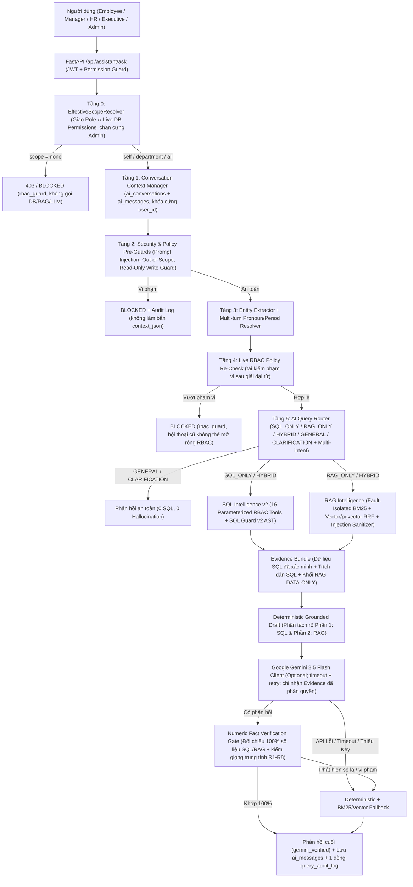
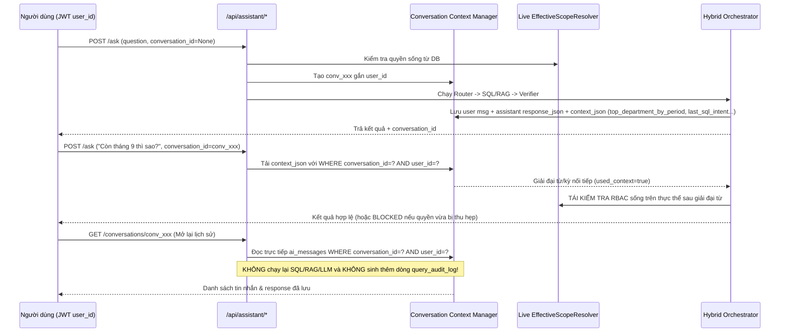

# KIẾN TRÚC HYBRID AI CORE — HR ATTENDANCE COPILOT (PHASE 3)

- **Phiên bản:** Phase 3 — Unified Hybrid AI Orchestrator (SQL Intelligence + RAG Intelligence + Gemini 2.5 Flash + Numeric Fact Verification + Multi-turn Context)
- **Ngày ban hành:** 2026-11-28
- **Phạm vi tương thích:** Dual-Engine (**SQLite** local/test và **Supabase PostgreSQL 15+ với `pgvector 0.8.2` & 29/29 bảng RLS**), 100% tương thích ngược với API và Frontend hiện có.

---

## 1. Sơ đồ kiến trúc tổng thể End-to-End



---

## 2. Luồng hội thoại nhiều lượt & Cách ly dữ liệu (Multi-turn Sequence)



---

## 3. Phân rã 6 thành phần cốt lõi của AI Core

### 3.1. AI Query Router (`backend/app/services/ai_router.py`)
- Phân loại rõ ràng 5 tuyến xử lý:
  - **`SQL_ONLY`**: Truy vấn số liệu vận hành đơn ý hoặc đa ý (`is_multi_intent = true`, tối đa 4 `SubQuery` trực giao: ví dụ quỹ phép + cảnh báo, nhân sự phòng + cảnh báo, đi muộn + đơn chờ duyệt).
  - **`RAG_ONLY`**: Câu hỏi nội quy, quy chế, quy trình, định nghĩa, hướng dẫn tự phục vụ (VD: TC-07 ân hạn 5 phút, TC-08 quy trình tạo/hủy đơn, TC-09 đổi mật khẩu `/profile`) và các câu hỏi ngoài miền nghiệp vụ (để Evidence Sufficiency Gate của RAG từ chối trung thực thay vì bịa).
  - **`HYBRID`**: Câu hỏi kết hợp đồng thời số liệu vận hành thực tế (SQL) và căn cứ quy định/quy trình nội bộ (RAG) — xử lý trọn vẹn TC-26..TC-30.
  - **`GENERAL`**: Chào hỏi hoặc hỏi khả năng hỗ trợ chung của Trợ lý AI theo đúng vai trò (không chạy SQL, không bịa số liệu).
  - **`CLARIFICATION`**: Câu hỏi quá ngắn hoặc mơ hồ (*"Xem giúp tôi"*, *"chấm công"*) → yêu cầu làm rõ chỉ số và kỳ.
- **Chống định tuyến sai với câu nhiều điều kiện:** Nhận diện trước các công cụ tổ hợp chuyên biệt (`compare_periods`, `compare_departments_full`, `employee_attendance_detail`, `employee_directory`), chỉ giữ toàn nguyên câu cho `RAG_ONLY` (tránh làm rơi cụm *"hủy đơn chờ duyệt"* khi tách chữ *"và"*), và loại bỏ biểu thức dải quy tắc `"R1-R8"` khỏi bộ lọc mã quy tắc đơn lẻ.

### 3.2. Hybrid Orchestrator (`backend/app/services/ai_orchestrator.py`)
- Điều phối tuần tự an toàn: **SQL Sub-queries** (chỉ gọi 16 tool tham số hóa có RBAC trong `ai_tools.py`, không bao giờ cho LLM tự thực thi SQL) + **RAG Sub-query** (gọi `query_rag_knowledge` có cô lập lỗi hoàn toàn).
- **Liên kết thông minh giữa các bước SQL và RAG trong truy vấn Hybrid:**
  - *TC-29 (R7 + OT + Chính sách):* Lấy nhân viên phát sinh R7 từ `list_anomalies_tool` → tự động đối chiếu bảng `overtime_requests` cho đúng nhân viên đó → kết hợp trích dẫn Điều 3 Nội quy về tăng ca cuối tuần.
  - *TC-30 (Rủi ro kỳ gần nhất + Cẩm nang R1–R8):* Lấy danh sách cảnh báo thực tế của kỳ mới nhất (`2026-11`: `R6`) → tự động bổ sung mã quy tắc quan sát được vào truy vấn RAG để kéo đúng quy trình xử lý từ Cẩm nang.
- **Phân tách rõ 2 phần trong phản hồi Hybrid:**
  - `### 1. Dữ liệu thực tế từ hệ thống (SQL)`
  - `### 2. Căn cứ quy định & quy trình nội bộ (RAG)`
- **Cô lập lỗi (Fault Isolation):** Nếu RAG lỗi tạm thời giữa truy vấn `HYBRID`, phần số liệu SQL vẫn thành công và thông báo rõ trạng thái RAG; không làm sập toàn bộ trợ lý.

### 3.3. Google Gemini 2.5 Flash Client (`backend/app/services/ai_llm_client.py`)
- Thiết kế provider abstraction (`BaseLLMProvider` → `GeminiLLMProvider`), mặc định model `gemini-2.5-flash` qua REST API `generateContent`.
- Đọc `LLM_API_KEY` / `GEMINI_API_KEY` hoàn toàn từ biến môi trường (truyền qua HTTP header `x-goog-api-key`, không lưu trong DB, không gắn vào URL query string).
- Có `timeout` cấu hình (`LLM_TIMEOUT_SECONDS`, mặc định `12s`) và `retry` có giới hạn với exponential backoff (`LLM_MAX_RETRIES`, mặc định `2`) chỉ cho lỗi tạm thời (`timeout`, `network_error`, HTTP `429/500/502/503/504`).
- **Ranh giới dữ liệu gửi cho LLM:** Prompt chỉ chứa `EvidenceBundle` đã lọc theo đúng RBAC của người dùng (mẫu tối đa 15 dòng) + khối RAG đã quét Prompt Injection bọc trong khung `BEGIN UNTRUSTED REFERENCE POLICY DATA (DATA ONLY)`.
- **Trung thực trạng thái:** Khi thiếu API key hoặc Gemini lỗi, trả `used_llm=false`, `used_fallback=true`, `fallback_reason` rõ ràng và chuyển mượt về **Deterministic + BM25/Vector Fallback**.

### 3.4. Numeric Fact Verification Gate (`backend/app/services/ai_fact_verifier.py`)
- Thu thập toàn bộ tập số liệu gốc được phép từ:
  1. Mọi dòng dữ liệu SQL (`rows`) và chỉ số suy diễn xác định (`derived_facts` như tổng phút muộn, chênh lệch tỷ lệ %, số ngày vượt quỹ).
  2. Nội dung sạch (`sanitized_content`) và metadata của các chunk RAG đã được xác thực.
- Hậu kiểm **100% mọi con số độc lập** trong văn bản do Gemini sinh ra (hỗ trợ cả dấu thập phân `.` và `,` tiếng Việt, dấu phân cách hàng nghìn `350.000`, tự động loại trừ mã định danh `NV007`, `R1..R8`, `DOC-1`, `#12`, `v2.0`).
- **Phân biệt `0` với `insufficient_data`:** Nếu SQL trả `insufficient_data` (không có bản ghi cho kỳ/nhân viên), bộ xác minh từ chối bất kỳ câu trả lời nào tự bịa `"0 lần"` / `"0 ngày"`. Ngược lại, khi có dữ liệu chấm công trong kỳ với 0 lần muộn (TC-04), số `0` được xác nhận hợp lệ.
- **Chặn rò rỉ & quy kết:** Từ chối ngay lập tức mọi văn bản có chứa số chưa xác minh, rò rỉ `password_hash`/`system_instruction`, hoặc lời quy kết vi phạm/gian lận trên cảnh báo R1–R8 → tự động fallback về bản nháp xác định đã kiểm chứng 100% và ghi cờ `llm_output_rejected = true`.

### 3.5. Conversation Context Manager (`backend/app/services/ai_context_manager.py`)
- Quản lý 2 bảng nhẹ `ai_conversations` và `ai_messages` trên cả SQLite và Supabase PostgreSQL (đã bật RLS và thu hồi quyền `anon`/`authenticated`).
- Mọi thao tác đọc, thêm lượt hỏi, xóa phiên đều khóa cứng `WHERE conversation_id = ? AND user_id = ?` (trả HTTP `404` chống dò mã hội thoại của người khác).
- Lưu trạng thái có cấu trúc `context_json` (`last_sql_intent`, `last_period`, `last_department`, `top_department_by_period`, `last_top_employee_id`, `last_rule_code`, `last_force_self`) để xử lý câu hỏi nối tiếp (*"Còn tháng 9 thì sao?"*, *"phòng đó"*, *"nhân viên đó"*).
- **Bảo đảm không mở rộng RBAC:** Mọi thực thể giải từ ngữ cảnh đều phải đi qua **Live RBAC Policy Re-Check** trước khi chạy công cụ.
- **Không lặp audit log:** `GET /api/assistant/conversations` và `GET /api/assistant/conversations/{id}` đọc thẳng từ `ai_conversations`/`ai_messages`, tuyệt đối không chạy lại SQL/LLM và không ghi thêm dòng vào `query_audit_log`.

---

## 4. Hợp đồng JSON phản hồi thống nhất (Sẵn sàng cho Phase 4 Frontend)

`POST /api/assistant/ask` giữ nguyên 100% các trường cũ (`status`, `answer`, `table`, `chart`, `trace`, `suggested_followups`) và bổ sung các trường có cấu trúc cho Phase 4:

```json
{
  "status": "success",
  "answer": "...",
  "conversation_id": "conv_9f2a...",
  "route": {
    "type": "HYBRID",
    "sub_queries": [{ "kind": "sql", "intent": "top_late_employees" }, { "kind": "rag", "intent": "policy_retrieval" }],
    "used_context": false,
    "is_multi_intent": true,
    "rationale": "..."
  },
  "table": { "columns": ["..."], "rows": [{}] },
  "column_labels": { "employee_id": "Mã NV", "late_days": "Số lần đi muộn" },
  "chart": { "type": "bar | line", "xKey": "...", "yKey": "...", "label": "...", "data": [] },
  "citations": {
    "sql": [{ "type": "sql", "source_label": "...", "scope_label": "...", "period": "2026-10", "record_count": 1, "verified": true }],
    "rag": [{ "type": "rag", "citation_id": "DOC-1", "document_id": 3, "title": "...", "version_label": "v1.1", "section_title": "...", "excerpt": "...", "scores": { "bm25": 63.17, "vector": 0.44, "hybrid": 0.80 } }]
  },
  "trace": { "tool_name": "...", "sql_text": "...", "row_count": 1, "execution_ms": 18.4 },
  "verification": {
    "verified": true,
    "mode": "gemini_verified | deterministic | deterministic_fallback_after_mismatch | deterministic_fallback_llm_unavailable",
    "checked_numbers": 8,
    "unverified_numbers": [],
    "llm_output_rejected": false,
    "flagged_unverified_numbers": []
  },
  "llm": { "provider": "gemini", "model": "gemini-2.5-flash", "used_llm": false, "used_fallback": true, "fallback_reason": "missing_api_key", "latency_ms": 0.0, "attempts": 0 },
  "suggested_followups": ["..."],
  "suggested_actions": [{ "label": "Mở Cảnh báo bất thường", "path": "/anomalies" }]
}
```
