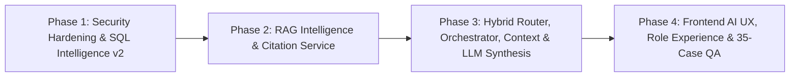

# LỘ TRÌNH NÂNG CẤP AI CORE — HYBRID AI ASSISTANT (SQL INTELLIGENCE + RAG)

- **Dự án:** HR Attendance Copilot
- **Ngày lập:** 2026-11-28
- **Nguyên tắc triển khai:** Nâng cấp tăng dần trên nền source code hiện có; giữ nguyên 100% tính năng đang hoạt động; không phá vỡ 65 Backend tests & 38 Frontend tests hiện có; tương thích song song **SQLite (local/test)** và **Supabase PostgreSQL (production + `pgvector` + RLS 100%)**.
- **Trạng thái:** Đề xuất kế hoạch — **Chờ xác nhận trước khi triển khai**.

---

## 1. Mục tiêu định lượng sau nâng cấp

| Chỉ tiêu (KPI) | Hiện trạng (Baseline) | Mục tiêu sau nâng cấp |
| --- | --- | --- |
| Tỷ lệ PASS trên bộ 35 test case (`AI_TEST_CASES.md`) | 20% (7/35) | **≥ 95% (≥ 33/35)** |
| Tỷ lệ PASS trên các ca bảo mật RBAC 5 vai trò & SQL Guard | 100% ca cơ bản (còn lỗ hổng dynamic perms & PG funcs) | **100% (0 lỗ hổng rò rỉ dữ liệu / bypass)** |
| Tỷ lệ bịa số liệu (Hallucination Rate) | 0% số ngẫu nhiên (nhưng có sai ngữ nghĩa) | **0% (100% số liệu qua `Numeric Fact Verification Gate`)** |
| Hỗ trợ câu hỏi nội quy / chính sách (RAG + Citations) | 0% | **100% tài liệu active trong Kho RAG + trích dẫn điều khoản** |
| Hỗ trợ câu hỏi nhiều ý & kết hợp SQL + RAG | 0% | **Đầy đủ (tách sub-query, hợp nhất evidence & citation)** |
| Duy trì ngữ cảnh hội thoại nhiều lượt (Multi-turn) | 0% (Stateless) | **Lưu theo `conversation_id`, cách ly theo `user_id`, tái kiểm RBAC** |
| Khả năng hoạt động khi không có LLM API key / mất mạng LLM | Hoạt động (rule-based) | **100% Graceful Fallback (BM25 RAG + Deterministic SQL Synthesis)** |

---

## 2. Lộ trình triển khai 4 Giai đoạn (Phased Roadmap)

---

### Phase 1 — Gia cố bảo mật RBAC/SQL Guard & Nâng cấp SQL Intelligence v2

**Mục tiêu:** Khắc phục triệt để các lỗi định tuyến, lỗi bỏ sót `target_emp`, lỗi hardcode kỳ `2026-10`, lỗi nhầm `0` vs `thiếu dữ liệu` và gia cố SQL Guard cho cả SQLite & Supabase PostgreSQL.

| Hạng mục | File dự kiến tác động | Chi tiết kỹ thuật |
| --- | --- | --- |
| **1.1. EffectiveScopeResolver** | `backend/app/core/security.py`, `backend/app/services/ai_tools.py`, `backend/app/services/sql_guard.py` | Tính phạm vi AI dựa trên **giao (`intersection`)** giữa `user.role` và permissions thực tế (`ai.ask.self` / `ai.ask.department` / `ai.ask.all` / `ai.strategy`). Giữ chặn 3 tầng cho `admin`. |
| **1.2. SQL Guard v2 (AST + PG Hardening)** | `backend/app/services/sql_guard.py`, `backend/requirements.txt` | Thêm `sqlglot` để parse AST (thay regex thuần), bắt buộc kiểm tra `ALLOWED_VIEW_COLUMNS`, chặn các hàm hệ thống PostgreSQL (`pg_sleep`, `pg_read_file`, `current_setting`, `set_config`, `dblink`, `version`, ...), đọc động `ai.sql_max_rows` & `ai.sql_timeout_seconds` từ `system_settings` (có trần an toàn cứng), đồng bộ cột `v_employees` / `v_leave_requests` giữa SQLite & PG. |
| **1.3. Mở rộng Semantic SQL Tool Catalog** | `backend/app/services/ai_tools.py` | - Truyền `target_employee_id` & `department_name` vào toàn bộ tool cần thiết. - Thêm 7 tool mới: `get_employee_directory_summary`, `get_employee_attendance_detail` (liệt kê ngày đi muộn/thiếu công), `list_leave_requests_detail` (hỗ trợ `status`, `requires_executive_approval`), `compare_periods`, `compare_departments_full` (dùng chung công thức `metrics_service.py`), `list_holidays_and_overtime`, `resolve_employee_in_scope` (tìm theo họ tên chỉ trong phạm vi RBAC). - Kiểm tra tồn tại nhân viên trước khi trả lời (`NV999` → báo không tìm thấy). - Phân biệt rõ `0 lần đi muộn` (khi có dữ liệu chấm công trong kỳ) với `insufficient_data` (kỳ không có dữ liệu). |
| **1.4. Dynamic Period & Department Resolver** | `backend/app/services/ai_assistant.py` (tách dần sang `ai_entities.py`) | Đọc kỳ mới nhất từ DB cho `"tháng này"`/`"kỳ gần nhất"` thay vì hardcode `2026-10`; hỗ trợ `"quý 1..4"`, khoảng ngày; đọc danh sách phòng ban động từ bảng `departments` và trích xuất được nhiều phòng ban cùng lúc (VD: Kinh doanh vs Kỹ thuật). |
| **1.5. Sửa False-Positive Guard** | `backend/app/services/ai_assistant.py` | Tinh chỉnh rule chặn để không chặn nhầm câu hợp lệ của Employee (*"top 3 ngày tôi đi muộn"*, *"làm sao đổi mật khẩu của tôi"*); xử lý ý hỏi cá nhân của Manager (*"bản thân tôi còn bao nhiêu ngày phép"*). |

**Tiêu chí nghiệm thu Phase 1:**
- 65/65 backend test cũ PASS + bổ sung unit tests cho `SQL Guard v2` (AST bypass, column allowlist, PG system functions, dynamic RBAC scope).
- Toàn bộ các ca `SQL_ONLY` trong Nhóm 1–4 của `AI_TEST_CASES.md` đạt PASS.

---

### Phase 2 — Xây dựng RAG Intelligence thực thụ & Citation Service

**Mục tiêu:** Biến bảng `company_documents` / `document_chunks` và trang `/admin/rag` từ "khung chờ" thành kho tri thức hoạt động thực sự, có tìm kiếm lai (BM25 + Vector) và trích dẫn chính xác đến từng điều khoản.

| Hạng mục | File dự kiến tác động | Chi tiết kỹ thuật |
| --- | --- | --- |
| **2.1. Bộ tài liệu nội quy chuẩn doanh nghiệp** | `backend/app/core/permissions.py` / `backend/app/db/rag_seed_docs/` | Thay 3 câu placeholder hiện tại bằng nội dung chuẩn đầy đủ (Markdown có cấu trúc Điều/Khoản rõ ràng) cho: 1. `Nội quy lao động Công ty 2026 (v2.0)` (giờ làm, nghỉ lễ, tăng ca, bảo mật tài khoản/đổi mật khẩu, kỷ luật lao động). 2. `Quy chế chấm công, đi muộn và nghỉ phép (v1.4)` (ca 08:30–17:30, ân hạn 5 phút, nghỉ trưa 1h, phép năm 12 ngày, cách tính ngày lịch, quy trình tạo/hủy/duyệt đơn & phê duyệt cấp cao). 3. `Cẩm nang định nghĩa và quy trình xử lý cảnh báo R1–R8 (v1.1)` (định nghĩa, ngưỡng, lưu ý trung tính và quy trình xử lý từng rule R1–R8). |
| **2.2. RAG Ingestion & Real Re-index** | `backend/app/services/ai_rag_service.py`, `backend/app/api/system_admin.py` | - Section-aware chunking (giữ heading/điều khoản + overlap 80–120 ký tự, đọc `embedding.chunk_size` từ `system_settings`). - Hỗ trợ tải lên file `.md`, `.txt`, `.pdf` (`pypdf`), `.docx` (`python-docx`) song song với nhập văn bản. - Nút `POST /api/rag/documents/{id}/reindex` thực sự tái tách chunk, cập nhật metadata mục và tính lại vector embedding. - Hỗ trợ metadata `visibility` (`all`, `manager_up`, `hr_exec_only`) trong JSON `metadata` (không cần phá vỡ schema bảng). |
| **2.3. Hybrid Retrieval Engine (BM25 + Vector + RRF)** | `backend/app/services/ai_rag_service.py` | - Tầng Lexical: BM25 hỗ trợ tiếng Việt có dấu & bỏ dấu, xử lý tốt mã `R1–R8`, số liệu quy định. - Tầng Semantic: Gọi embedding provider (nếu cấu hình API key) và truy vấn `pgvector` trên Supabase PostgreSQL (`embedding <=> query_vec`), tự động fallback mượt về BM25 trên SQLite/offline. - Trộn xếp hạng bằng Reciprocal Rank Fusion (RRF) + áp ngưỡng liên quan tối thiểu (`min_score`) để từ chối trung thực khi không tìm thấy tài liệu. |
| **2.4. Citation Service** | `backend/app/services/ai_citation_service.py` | Chuẩn hóa schema `citations` trả về gồm `sql_citations` (tên nguồn nghiệp vụ, phạm vi RBAC, kỳ, số bản ghi, trạng thái kiểm chứng) và `rag_citations` (document_id, title, version, section, excerpt, relevance_score). |

**Tiêu chí nghiệm thu Phase 2:**
- Các ca `RAG_ONLY` (TC-07, TC-08, TC-09) đạt PASS 100% có trích dẫn tài liệu & điều khoản chính xác.
- Re-index hoạt động thực tế trên cả SQLite & Supabase PostgreSQL; tài liệu có `visibility = hr_exec_only` tuyệt đối không trả về cho Employee/Manager.

---

### Phase 3 — AI Query Router, Hybrid Orchestrator, Conversation Context & Grounded Synthesis

**Mục tiêu:** Kết nối SQL Intelligence và RAG Intelligence thành một **Hybrid AI Assistant** hoàn chỉnh có khả năng xử lý câu hỏi nhiều ý, ghi nhớ ngữ cảnh theo phiên và kiểm chứng 100% số liệu đầu ra.

| Hạng mục | File dự kiến tác động | Chi tiết kỹ thuật |
| --- | --- | --- |
| **3.1. Conversation Context Manager & Schema Migration an toàn** | `backend/app/db/schema.sql`, `backend/app/db/schema_postgres.sql`, `backend/app/db/migrations.py`, `backend/app/services/ai_context_manager.py` | - Bổ sung 2 bảng nhẹ (non-destructive migration + **bật RLS + REVOKE `anon`/`authenticated`** trên Supabase ngay trong migration):   - `ai_conversations (conversation_id, user_id, title, context_json, created_at, updated_at)`   - `ai_messages (message_id, conversation_id, role, content, response_json, created_at)` - Quản lý ngữ cảnh 5–6 lượt gần nhất + `context_state` (`last_period`, `last_department`, `last_employee_id`, `last_rule_code`, `last_intent`). - Mọi truy vấn session ép `user_id = current_user.user_id`; sau khi giải đại từ nối tiếp bắt buộc chạy lại `RBAC Policy Gate`. |
| **3.2. AI Query Router (Multi-intent)** | `backend/app/services/ai_router.py` | Phân loại `SQL_ONLY`, `RAG_ONLY`, `HYBRID`, `READ_ONLY_GUIDANCE`, `CLARIFICATION`, `BLOCKED`. Tách câu hỏi nhiều ý thành tối đa 3–4 `SubQuery` độc lập. Hỗ trợ Fast-path + LLM JSON Structured Router + Deterministic Fallback. |
| **3.3. Hybrid Orchestrator** | `backend/app/services/ai_orchestrator.py` | Thực thi kế hoạch sub-queries qua SQL Intelligence + RAG Intelligence, gom về `EvidenceBundle`, kiểm soát tổng thời gian thực thi, hỗ trợ `Controlled Text-to-SQL` (qua `SQL Guard v2`) cho câu hỏi ad-hoc khi không khớp 16 tool có sẵn. Đảm bảo Read-Only tuyệt đối (trả hướng dẫn + `suggested_actions` deep-link cho yêu cầu ghi). |
| **3.4. LLM Adapter & Grounded Response Generator** | `backend/app/core/config.py`, `backend/app/services/ai_llm_client.py`, `backend/app/services/ai_response_generator.py` | - Đọc `LLM_PROVIDER` (`gemini` / `openai`), `LLM_API_KEY`, `LLM_MODEL` từ env (kết hợp chọn provider không chứa secret từ `system_settings`). - **Numeric & Fact Verification Gate** (kế thừa `verify_narrative_numbers` của `report_service.py`): đối chiếu mọi con số trong câu trả lời LLM với `EvidenceBundle`; nếu phát hiện sai lệch → tự động fallback về câu trả lời template có kiểm chứng và ghi nhận cờ kiểm toán. - Giữ giọng văn trung tính cho R1–R8; trả `column_labels` tiếng Việt và `chart.type` (`bar` / `line`) phù hợp. |
| **3.5. Mở rộng API `/api/assistant/*` & Audit Log** | `backend/app/api/assistant.py`, `backend/app/api/system_admin.py` | - `POST /api/assistant/ask` hỗ trợ thêm `conversation_id` (optional — tương thích ngược 100% với client cũ) và `active_period` (optional hint từ UI). - Thêm `GET /api/assistant/conversations`, `GET /api/assistant/conversations/{id}`, `DELETE /api/assistant/conversations/{id}` (cô lập tuyệt đối theo `user_id`). - Ghi đầy đủ `query_type` (`ai_sql`, `ai_rag`, `ai_hybrid`, `ai_strategy`, `rbac_block`), danh sách tool/doc_ids và trạng thái verification vào `query_audit_log`. |

**Tiêu chí nghiệm thu Phase 3:**
- Toàn bộ Nhóm 5 (Hybrid TC-26..TC-30) và Nhóm 6 (Security + Multi-turn TC-31..TC-35) đạt PASS.
- Thử nghiệm tắt `LLM_API_KEY` (chế độ offline) hệ thống vẫn trả lời chính xác cả SQL + BM25 RAG mà không crash.
- Kiểm chứng Supabase PostgreSQL: 29/29 bảng bật RLS, không lộ dữ liệu cho `anon`/`authenticated`.

---

### Phase 4 — Nâng cấp Frontend AI UX theo 5 vai trò & Kiểm thử toàn diện

**Mục tiêu:** Đưa trải nghiệm Trợ lý AI trên giao diện lên chuẩn doanh nghiệp: tách bạch vai trò, trích dẫn rõ ràng, lịch sử hội thoại thực sự, bảng/biểu đồ thân thiện và kiểm chứng End-to-End.

| Hạng mục | File dự kiến tác động | Chi tiết kỹ thuật |
| --- | --- | --- |
| **4.1. Nâng cấp `AssistantPage.tsx` & Sub-components** | `frontend/src/pages/AssistantPage.tsx`, `frontend/src/components/assistant/` (tạo mới: `CitationCards.tsx`, `AssistantTable.tsx`, `AssistantChart.tsx`, `ConversationSidebar.tsx`) | - **Role Scope Header:** Đọc `useAuth()` hiển thị badge phạm vi thực tế (*Dữ liệu cá nhân*, *Phòng Kinh doanh*, *Toàn công ty – HR*, *Phân tích điều hành*) + đồng bộ `selectedPeriod`. - **Lịch sử hội thoại đúng nghĩa:** Click phiên hội thoại tải lại toàn bộ tin nhắn (`GET /api/assistant/conversations/{id}`), **KHÔNG gửi lại câu hỏi**; hỗ trợ tạo hội thoại mới & xóa hội thoại cá nhân. - **Citation Rendering:** Hiển thị thẻ **Nguồn dữ liệu (SQL)** thân thiện + thẻ **Trích dẫn tài liệu (RAG)** có thể mở xem đoạn trích & điều khoản; thu gọn SQL Trace kỹ thuật. - **Bảng & Biểu đồ doanh nghiệp:** Hiển thị tiêu đề cột tiếng Việt (dùng `column_labels`, không lộ `snake_case`), thông báo rõ nếu bảng có nhiều hơn 10 dòng kèm nút mở rộng; hỗ trợ cả `BarChart` và `LineChart` (xu hướng). - **Chat UX:** Textarea hỗ trợ Enter gửi / Shift+Enter xuống dòng, giới hạn 1000 ký tự, auto-scroll, render Markdown an toàn (không `dangerouslySetInnerHTML`), hiển thị chip `suggested_followups` & nút điều hướng an toàn (`suggested_actions`), loading stepper theo trạng thái + hỗ trợ hủy (`AbortController`), thẻ trạng thái khác biệt cho `blocked` / `insufficient_data` / `clarification_needed` / `error` (kèm nút Thử lại). |
| **4.2. Nâng cấp `RagKnowledgePage.tsx` & `AuditLogsPage.tsx`** | `frontend/src/pages/RagKnowledgePage.tsx`, `frontend/src/pages/AuditLogsPage.tsx` | - `/admin/rag`: Cho phép upload file `.md/.txt/.pdf/.docx`, chọn mức hiển thị `visibility`, xem danh sách chunks đã tách sau index. - `/admin/audit`: Thêm bộ lọc `query_type` (`ai_sql`, `ai_rag`, `ai_hybrid`, `ai_strategy`, `rbac_block`) và hiển thị trạng thái xác minh số liệu. |
| **4.3. Bộ kiểm thử tự động & Nghiệm thu** | `backend/tests/test_ai_hybrid_evaluation.py`, `frontend/src/__tests__/AssistantPage.test.tsx` | - Tự động hóa toàn bộ **35 câu hỏi trong `AI_TEST_CASES.md`** (chạy thật trên FastAPI + SQLite & kiểm chứng live trên Supabase PostgreSQL). - Unit/integration test Frontend cho citations, multi-turn sidebar, Vietnamese columns, blocked/error states, role badges. - Kiểm tra `pytest`, `vitest`, `npm run build` và kiểm tra trực quan trên trình duyệt thực tế cho 4 vai trò có AI + xác nhận chặn Admin. |

---

## 3. Phân tích rủi ro & Biện pháp kiểm soát

| Rủi ro | Mức độ | Biện pháp giảm thiểu |
| --- | :---: | --- |
| **R1. LLM bịa số liệu hoặc kết luận vi phạm nhân viên** | Cao | 100% số liệu tính từ SQL; bắt buộc chạy `Numeric & Fact Verification Gate` hậu kiểm trước khi trả về; tự động fallback về template xác định nếu phát hiện số lạ; chèn lưu ý trung tính cố định cho cảnh báo R1–R8. |
| **R2. LLM sinh SQL độc hại hoặc vượt phạm vi RBAC** | Cao | Ưu tiên tuyệt đối 16 parameterized tools; chỉ dùng Text-to-SQL khi ad-hoc và bắt buộc qua `SQL Guard v2` (AST parser + column allowlist + RBAC `TEMP VIEW` + `READ ONLY` + timeout). |
| **R3. Độ trễ cao / hết quota LLM API khi demo hoặc vận hành** | Trung bình | Fast-path deterministic không tốn gọi LLM cho các câu hỏi chuẩn; thiết lập timeout cứng cho LLM call (ví dụ 8–10s) và tự động fallback về BM25 + Deterministic Template. |
| **R4. Khác biệt SQLite (dev/test) vs Supabase PostgreSQL (prod)** | Trung bình | Giữ adapter `PostgresCompatConnection`; test đồng thời cả SQLite và kiểm chứng trực tiếp trên Supabase PostgreSQL; BM25 hoạt động độc lập DB, vector search dùng `pgvector` khi kết nối PG. |
| **R5. Rò rỉ ngữ cảnh hội thoại giữa người dùng hoặc khi đổi quyền** | Cao | Khóa cứng `user_id` ở mọi API hội thoại; tái chạy `EffectiveScopeResolver` và `RBAC Policy Gate` sau mỗi lần giải đại từ ngữ cảnh. |

---

## 4. Điểm cần xác nhận trước khi triển khai

Trước khi bắt đầu viết code theo lộ trình trên, vui lòng xác nhận 3 lựa chọn ngắn:

1. **Phạm vi triển khai:** Thực hiện lần lượt từng Phase (Phase 1 → 2 → 3 → 4, báo cáo nghiệm thu sau mỗi Phase) hay triển khai liên tục toàn bộ Phase 1–4?
2. **Nhà cung cấp LLM mặc định:** Dự án ưu tiên kết nối **Google Gemini** (`gemini-2.5-flash` như `.env.example` hiện tại) kèm **Deterministic/BM25 Fallback** khi chưa cấu hình API key, hay cần hỗ trợ thêm **OpenAI** ngay trong Phase 3?
3. **Upload tài liệu RAG:** Ở Phase 2, có cần hỗ trợ upload file nhị phân `.pdf`/`.docx` ngay lập tức (cài thêm `pypdf`, `python-docx`) cùng với Markdown/Text không?
