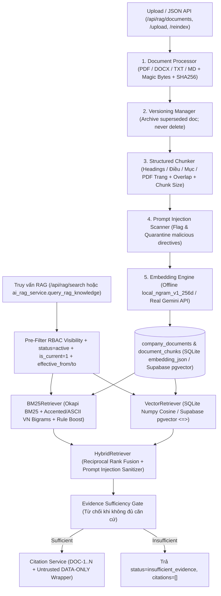

# BÁO CÁO TRIỂN KHAI PHASE 2: RAG INTELLIGENCE — HR ATTENDANCE COPILOT

- **Ngày hoàn thành:** 2026-11-28
- **Phạm vi:** Xây dựng hệ thống RAG Intelligence thực thụ (Document Processing PDF/DOCX/TXT/MD, Structured Chunking, Offline + Gemini Embedding Engine, Okapi BM25, Vector Search & Supabase `pgvector`, Hybrid RRF Retrieval, Real Re-index, Document Versioning & Effective Dates, Indirect Prompt Injection Defense, Role Visibility Access Control & Citation Service) sẵn sàng cho Phase 3 Hybrid SQL + RAG.
- **Nguyên tắc tuân thủ:** Tận dụng bảng `company_documents` & `document_chunks` hiện có (0 bảng trùng), không xóa dữ liệu thực tế, giữ 27/27 bảng RLS trên Supabase PostgreSQL, không ảnh hưởng SQL Intelligence hay Frontend hiện có, chỉ dừng đúng phạm vi Phase 2.

---

## 1. Kiến trúc RAG Intelligence đã triển khai



---

## 2. Danh sách file thay đổi & tạo mới

| File | Trạng thái | Vai trò kỹ thuật |
| --- | --- | --- |
| `backend/requirements.txt` | Sửa | Bổ sung tường minh `pypdf>=5.0.0`, `python-docx>=1.1.0`, `numpy>=1.26.0`. |
| `backend/app/db/schema.sql` | Sửa | Mở rộng không phá hủy bảng `company_documents` (`source_content`, `visibility`, `effective_from`, `effective_to`, `is_current`, `supersedes_document_id`) và `document_chunks` (`embedding_json`, `embedding_dim`). |
| `backend/app/db/schema_postgres.sql` | Sửa | Đồng bộ cột mở rộng trên `public.company_documents` và `public.document_chunks` (`embedding_dim` cạnh cột `embedding vector` có sẵn). |
| `backend/app/db/migrations.py` | Sửa | Bổ sung `ensure_rag_phase2_schema()` và `migrate_rag_phase2()` idempotent cho cả SQLite & Supabase PG (kèm xác minh RLS và nâng cấp an toàn 3 tài liệu stub mặc định). |
| `backend/app/services/rag_document_processor.py` | Tạo mới | Kiểm tra kích thước (≤ 10MB), phần mở rộng, chữ ký magic bytes (`%PDF-`, `PK\x03\x04` + `word/document.xml`, chống binary `\x00`), trích xuất văn bản thực cho **PDF (`pypdf`)**, **DOCX (`python-docx` gồm headings + bảng)**, **TXT**, **MD** và tính `checksum_sha256`. |
| `backend/app/services/rag_security.py` | Tạo mới | Phân quyền đọc tài liệu theo 5 vai trò (`all`, `manager_up`, `hr_exec_only`, `hr_only`; chặn Admin khỏi truy xuất nghiệp vụ AI), quét & cách ly Prompt Injection gián tiếp trong tài liệu, bọc dữ liệu truy xuất trong khung `DATA-ONLY`. |
| `backend/app/services/rag_chunker.py` | Tạo mới | Chunking Engine có cấu trúc nhận diện tiêu đề Markdown (`#`/`##`/`###`), `Điều`/`Khoản`/`Mục`/`Quy tắc R1–R8`, đánh dấu `[Trang N]` từ PDF, tách theo câu có `chunk_overlap` và đọc `embedding.chunk_size` từ `system_settings`. |
| `backend/app/services/rag_embeddings.py` | Tạo mới | Provider Abstraction (`EmbeddingProvider`):<br>- **Offline:** `LocalFeatureHashEmbeddingProvider` (`local_ngram_v1_256d`, 256 chiều chuẩn hóa L2, dùng `blake2b` xác định tuyệt đối, hỗ trợ unigrams/bigrams tiếng Việt có dấu + không dấu + char 3–4 grams + domain concepts).<br>- **Cloud:** `GeminiEmbeddingProvider` gọi thực tế Google Gemini `embedContent` qua `httpx`.<br>- **Trung thực tuyệt đối:** Không giả lập cloud embedding khi thiếu `LLM_API_KEY`; luôn ghi rõ `embedding_model` thực tế và cờ `offline_fallback`. |
| `backend/app/services/rag_retriever.py` | Tạo mới | Triển khai `BM25Retriever` (Okapi BM25), `VectorRetriever` (chạy thực `OPERATOR(extensions.<=>)` `pgvector` trên Supabase PG và cosine `numpy` trên SQLite), `HybridRetriever` (RRF + Prompt Injection Sanitizer + Evidence Sufficiency Gate). |
| `backend/app/services/ai_citation_service.py` | Tạo mới | `Citation Service` tạo trích dẫn `RagCitation` (`DOC-1..N`, tên tài liệu, phiên bản, điều/mục, trang, `chunk_id`, đoạn trích đã làm sạch, điểm BM25/Vector/Hybrid) và `SqlCitation` chuẩn bị cho Phase 3. |
| `backend/app/services/rag_seed_content.py` | Tạo mới | Nội dung chính sách tiếng Việt chuẩn doanh nghiệp (khớp 100% quy tắc trong `config.py`, `operations.py`, `anomaly_service.py`) cho 3 tài liệu gốc: Nội quy lao động 2026 (`v2.0`), Quy chế chấm công & nghỉ phép (`v1.4`), Cẩm nang cảnh báo R1–R8 (`v1.1`). |
| `backend/app/services/ai_rag_service.py` | Tạo mới | Facade thống nhất: `ingest_rag_document()`, `reindex_rag_document_real()`, `archive_rag_document()`, `upgrade_placeholder_seed_documents()`, và `query_rag_knowledge()` (cô lập lỗi hoàn toàn để lỗi RAG không bao giờ ảnh hưởng SQL Intelligence). |
| `backend/app/api/system_admin.py` | Sửa | Nâng cấp các endpoint `/api/rag/documents` hiện có (tương thích ngược 100%), bổ sung `POST /api/rag/documents/upload` (multipart PDF/DOCX/TXT/MD), `GET /api/rag/documents/{id}/chunks`, `POST /api/rag/documents/{id}/archive`, chuyển `POST /api/rag/documents/{id}/reindex` thành **Real Re-index**, và thêm `POST /api/rag/search` (có RBAC scope). |
| `backend/tests/test_ai_phase2_rag_intelligence.py` | Tạo mới | Bộ kiểm thử chuyên biệt Phase 2 gồm 6 suite test bao phủ toàn bộ 12 nhóm yêu cầu kiểm thử. |

*Frontend: **0 file thay đổi** (giao diện hiện tại giữ nguyên 100% ổn định).*

---

## 3. Chi tiết Database Migration, RLS & Khả năng Rollback

### 3.1. Thay đổi Schema (0 bảng mới, 0 xóa dữ liệu)

- **Bảng `company_documents` (tận dụng bảng hiện có):**
  - Thêm 6 cột không phá hủy: `source_content`, `visibility` (mặc định `'all'`), `effective_from`, `effective_to`, `is_current` (mặc định `1`), `supersedes_document_id`.
  - Tạo index `idx_company_documents_active_vis(status, is_current, visibility)`.
- **Bảng `document_chunks` (tận dụng bảng hiện có):**
  - Trên **Supabase PostgreSQL**: giữ nguyên cột `embedding vector` (`pgvector 0.8.2`, schema `extensions`), bổ sung `embedding_dim INTEGER`.
  - Trên **SQLite**: bổ sung `embedding_json TEXT` và `embedding_dim INTEGER`.
- **Nâng cấp tài liệu mặc định (idempotent):** Chỉ nâng cấp 3 bản ghi stub seed ban đầu (câu placeholder ~110 ký tự) thành **29 đoạn tri thức có cấu trúc và vector `256-d`** (Nội quy 2026: 7 chunks, Quy chế chấm công: 8 chunks, Cẩm nang R1–R8: 14 chunks). Không chạm tới bất kỳ tài liệu người dùng nào tải lên.

### 3.2. Kiểm tra RLS trên Live Supabase PostgreSQL

- Đã chạy kiểm chứng trực tiếp trên Supabase PostgreSQL (`pg_tables`): **27/27 bảng bật `rowsecurity = true`** (bao gồm `public.company_documents` và `public.document_chunks`).
- `pgvector` phiên bản `0.8.2` hoạt động trực tiếp với toán tử `OPERATOR(extensions.<=>)` trên cả 29/29 chunks (`embedded_chunks = 29/29`, `embedding_dim = 256`).

### 3.3. Kịch bản Rollback an toàn (PostgreSQL)

Nếu cần hoàn tác schema Phase 2 mà không ảnh hưởng dữ liệu cốt lõi:

```sql
BEGIN;
DROP INDEX IF EXISTS public.idx_company_documents_active_vis;
ALTER TABLE public.company_documents
  DROP COLUMN IF EXISTS supersedes_document_id,
  DROP COLUMN IF EXISTS is_current,
  DROP COLUMN IF EXISTS effective_to,
  DROP COLUMN IF EXISTS effective_from,
  DROP COLUMN IF EXISTS visibility,
  DROP COLUMN IF EXISTS source_content;
ALTER TABLE public.document_chunks
  DROP COLUMN IF EXISTS embedding_dim;
COMMIT;
```

---

## 4. Hạn chế & Rủi ro cần lưu ý cho Phase 3

1. **PDF dạng ảnh scan (chưa có lớp text):** `pypdf` từ chối trung thực với thông báo lỗi rõ ràng (HTTP 400) vì không có OCR engine; đây là hành vi an toàn (không lưu chunk rỗng).
2. **Chất lượng ngữ nghĩa của Local Offline Embedding vs Cloud Embedding:** `local_ngram_v1_256d` cho độ chính xác rất cao với thuật ngữ tiếng Việt chuyên ngành HR và chạy 100% offline không tốn chi phí; tuy nhiên khi câu hỏi diễn đạt hoàn toàn bằng từ đồng nghĩa ẩn dụ ngoài từ điển (paraphrasing sâu), việc cấu hình `LLM_API_KEY` + `embedding.provider = gemini` (`text-embedding-004`) và chạy **Real Re-index** sẽ nâng cao hơn nữa chất lượng Vector Search.
3. **Chỉ mục HNSW/IVFFlat trên `pgvector`:** Với quy mô hiện tại (~29–500 chunks), exact cosine scan trên Supabase mất `~125–219 ms` (bao gồm network round-trip tới Singapore/Tokyo pooler). Khi kho tài liệu vượt > 5.000 chunks và cố định 1 dimension chuẩn (`vector(256)` hoặc `vector(768)`), có thể tạo thêm chỉ mục HNSW.
4. **Điểm tích hợp sang Phase 3:** `ai_rag_service.query_rag_knowledge()` đã xuất sẵn cấu trúc `citations`, `untrusted_context_block` (`DATA-ONLY`), `sufficient_evidence`, `metrics` và `status` để **AI Query Router & Hybrid Orchestrator (Phase 3)** kết hợp trực tiếp với SQL Intelligence mà không cần viết lại tầng RAG.

> Chi tiết đầy đủ toàn bộ kết quả chạy test, độ trễ truy xuất đo thực tế trên SQLite và Live Supabase PostgreSQL xem tại [RAG_TEST_REPORT.md](file:///c:/Users/DEll/OneDrive/Dokumen/code/AI%20buildathon/docs/RAG_TEST_REPORT.md).
