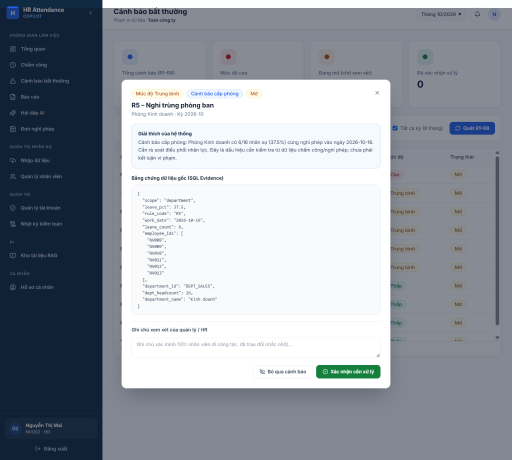
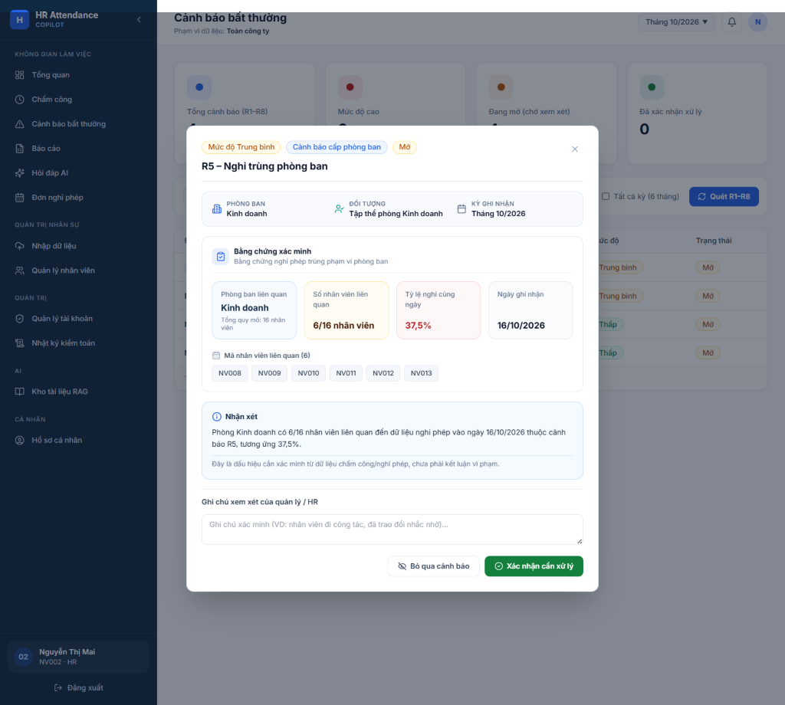

# Báo cáo Refactor UI – Thay thế SQL Evidence bằng Bằng chứng Nghiệp vụ (`BusinessEvidence`)

- **Dự án**: HR Attendance Copilot
- **Ngày thực hiện**: `28/11/2026`
- **Phạm vi**: Chuyển đổi toàn bộ phần hiển thị `Bằng chứng dữ liệu gốc (SQL Evidence)` dạng JSON thô trong modal chi tiết cảnh báo `R1–R8` sang giao diện nghiệp vụ tiếng Việt trực quan (`BusinessEvidence`), **giữ nguyên 100% dữ liệu `evidence` trong Database, API và thuật toán phát hiện `R1–R8`**.

---

## 1. Các file đã sửa và tạo mới

| Trạng thái | File | Vai trò |
|---|---|---|
| **Mới** | `frontend/src/utils/businessEvidence.ts` | Bộ chuyển đổi dữ liệu `evidence_data` cho đầy đủ 8 quy tắc `R1–R8` (bám sát 100% định nghĩa thực tế trong `backend/app/services/anomaly_service.py`), định dạng số/phần trăm/ngày chuẩn Việt Nam (`37,5%`, `16/10/2026`), và xử lý an toàn `null`/`undefined`/`NaN`/tỷ lệ `0%`. |
| **Mới** | `frontend/src/components/anomalies/BusinessEvidence.tsx` | Component hiển thị khối **"Bằng chứng xác minh"** (3–4 thẻ chỉ số gọn rõ + danh sách thẻ ngày/mã NV) và phần **"Nhận xét"** bằng ngôn ngữ tự nhiên kèm tuyên bố trung lập, hoàn toàn không dùng `<pre>` hay `JSON.stringify`. |
| **Sửa** | `frontend/src/pages/AnomaliesPage.tsx` | Thiết kế lại modal chi tiết cảnh báo theo bố cục 6 phần: (1) Tiêu đề & mức độ/trạng thái, (2) Thanh thông tin phòng ban/đối tượng/kỳ, (3) Khối Bằng chứng xác minh, (4) Nhận xét ngôn ngữ tự nhiên, (5) Ghi chú xem xét Manager/HR, (6) Nút Bỏ qua / Xác nhận cần xử lý. |
| **Mới** | `frontend/src/__tests__/BusinessEvidence.test.tsx` | 11 bài kiểm thử Vitest bao phủ cả 8 quy tắc `R1–R8`, trường hợp thiếu/rỗng/`null`/tỷ lệ `0%`/rule lạ, kiểm tra không xuất hiện tên biến kỹ thuật hay `undefined`/`null`/`NaN`, và kiểm thử luồng ghi chú & xác nhận xử lý trên `AnomaliesPage`. |
| **Mới** | `docs/assets/anomalies_evidence_before_r5.png` & `docs/assets/anomalies_evidence_after_r5.png` | Ảnh chụp giao diện thực tế **Trước** và **Sau** khi refactor trên cùng bản ghi cảnh báo `R5` (`/anomalies/7`). |

> **Bảo toàn dữ liệu kỹ thuật & tương thích API**: Không chỉnh sửa bảng `anomalies`, không xóa trường `evidence` / `evidence_data` khỏi DB hay REST API, không sửa 8 file SQL `r1..r8.sql` (`backend/sql/` & `backend/sql_postgres/`).

---

## 2. Các loại Evidence đã hỗ trợ (`R1–R8` bám sát định nghĩa thực tế trong mã nguồn)

Mỗi quy tắc có mẫu chuyển đổi chỉ số và câu nhận xét riêng tương ứng với cấu trúc `evidence` thực tế sinh ra bởi `backend/app/services/anomaly_service.py`:

| Quy tắc | Định nghĩa thực tế trong source | Chỉ số thẻ nghiệp vụ hiển thị | Danh sách thẻ chi tiết |
|---|---|---|---|
| **R1** (`late_repeated`) | Đi muộn lặp lại nhiều ngày quá mốc ân hạn (`>5` phút) | Số ngày đi muộn (kèm ngưỡng), Biên độ trễ (`min – max` phút, kèm ân hạn), Phòng ban & Kỳ | Các ngày đi muộn tiêu biểu (`DD/MM/YYYY`) |
| **R2** (`missing_punch`) | Thiếu dữ liệu chấm công giờ vào hoặc giờ ra | Số ngày thiếu giờ vào/ra (kèm ngưỡng), Phòng ban liên quan, Kỳ ghi nhận | Các ngày thiếu dữ liệu chấm công (`DD/MM/YYYY`) |
| **R3** (`low_hours`) | Số giờ làm việc thấp hơn định mức chuẩn (`<7` giờ/ngày) | Số ngày thiếu giờ chuẩn (kèm ngưỡng), Giờ công trung bình/ngày, Phòng ban & Kỳ | Các ngày có số giờ làm việc thấp (`DD/MM/YYYY`) |
| **R4** (`leave_near_holiday`) | Nghỉ phép đã duyệt nằm sát kỳ nghỉ lễ (`±3` ngày) | Dịp nghỉ lễ & ngày lễ, Số đơn nghỉ phép (kèm cửa sổ `±3` ngày), Phòng ban & Kỳ | Các khoảng thời gian nghỉ phép đã duyệt |
| **R5** (`leave_cluster`) | Nhiều nhân sự cùng phòng nghỉ phép trùng một ngày | Phòng ban liên quan (kèm tổng quy mô NV), Số nhân viên liên quan (`6/16 nhân viên`), Tỷ lệ nghỉ cùng ngày (`37,5%`), Ngày ghi nhận (`16/10/2026`) | Mã nhân viên liên quan (`NV008`…`NV013`) |
| **R6** (`identical_punch`) | Nhiều ngày có giờ vào & giờ ra trùng khớp đến từng giây | Số ngày trùng mốc giờ (kèm ngưỡng), Mốc giờ vào lặp lại, Mốc giờ ra lặp lại | Các ngày ghi nhận trùng mốc giờ (`DD/MM/YYYY`) |
| **R7** (`weekend_punch`) | Chấm công vào cuối tuần / ngày lễ khi chưa có đơn OT duyệt | Số ngày cuối tuần / lễ, Trạng thái đơn tăng ca (`Chưa có đơn OT duyệt`), Phòng ban & Kỳ | Các ngày cuối tuần / ngày lễ ghi nhận (`DD/MM/YYYY`) |
| **R8** (`leave_over_balance`) | Tổng ngày phép năm đã duyệt (tính theo ngày lịch) vượt định mức | Định mức phép năm, Tổng phép đã duyệt (kèm số đơn), Số ngày vượt quỹ phép (`+X ngày`) | Các kỳ nghỉ phép năm đã duyệt |

**Ví dụ câu nhận xét chuẩn nghiệp vụ thực tế cho `R5`:**
> *"Phòng Kinh doanh có 6/16 nhân viên liên quan đến dữ liệu nghỉ phép vào ngày 16/10/2026 thuộc cảnh báo R5, tương ứng 37,5%."*
> Kèm tuyên bố trung lập: *"Đây là dấu hiệu cần xác minh từ dữ liệu chấm công/nghỉ phép, chưa phải kết luận vi phạm."*

---

## 3. Ảnh giao diện Trước và Sau (Cảnh báo `R5` – Phòng Kinh doanh)

### Trước khi refactor (Hiển thị JSON thô `SQL Evidence`)

### Sau khi refactor (`BusinessEvidence` – Thẻ chỉ số & Nhận xét tiếng Việt)

---

## 4. Kết quả kiểm thử thực tế

| Hạng mục kiểm thử | Lệnh chạy thực tế | Kết quả | Chi tiết |
|---|---|---|---|
| **Backend Full Pytest Suite** | `cd backend; python -m pytest -v` | **PASS (65/65)** | `65 passed, 2 warnings in 28.55s` — toàn bộ API `anomalies`, `R1–R8`, RBAC 5 vai trò giữ nguyên 100% tương thích |
| **Frontend Full Vitest Suite** | `cd frontend; npm test -- --run` | **PASS (38/38)** | `5 passed (5), 38 passed (38) in 7.02s` — gồm 11 test mới trong `BusinessEvidence.test.tsx` kiểm tra đủ `R1–R8`, `null`/thiếu trường, tỷ lệ `0%`, không `undefined`/`null`/`NaN`/tên biến kỹ thuật, và gửi ghi chú xử lý |
| **Frontend TypeScript & Build** | `cd frontend; npm run build` | **PASS** | `tsc -b && vite build` `✓ built in 6.17s`, 0 lỗi TypeScript, 0 cảnh báo chunk > 500 kB |
| **Kiểm tra trực quan trên trình duyệt thật** | Đăng nhập `hr@company.vn` tại `http://127.0.0.1:5173/anomalies/7` (`1280×1150`) | **PASS** | `0` thẻ `<pre>`, không còn `SQL Evidence` hay tên biến (`dept_headcount`, `leave_pct`, `employee_ids`...), hiển thị đủ 6 phần bố cục sạch sẽ, không tràn/cắt chữ |

---

## 5. Những trường hợp chưa thể chuyển đổi sang ngôn ngữ nghiệp vụ

1. **Mã quy tắc ngoài `R1–R8` (tùy biến mới phát sinh trong tương lai)**: Nếu sau này bổ sung quy tắc mới (ví dụ `R9`, `R10`) mà chưa cập nhật nhánh tương ứng trong `frontend/src/utils/businessEvidence.ts`, giao diện sẽ tự động chuyển về **chế độ dự phòng an toàn** (hiển thị 3 thẻ bối cảnh Phòng ban / Phạm vi / Kỳ + giải thích `explanation` + ghi chú hướng dẫn đối chiếu trực tiếp), tuyệt đối không đổ JSON thô ra màn hình nghiệp vụ.
2. **Các trường động tùy ý chưa định nghĩa trong schema `evidence` hiện tại**: Các key lạ không nằm trong tập trường đã chuẩn hóa của `R1–R8` sẽ không được hiển thị thô ở UI HR/Manager/Employee (dữ liệu gốc vẫn được lưu đầy đủ trong cột `anomalies.evidence` của CSDL để phục vụ truy vết kỹ thuật).
3. **Bản ghi cũ bị thiếu/rỗng `evidence_data` (`null` hoặc `{}`)**: Hệ thống không tự suy diễn số liệu; các chỉ số thiếu hiển thị rõ `"Chưa ghi nhận"` kèm thông báo hướng dẫn đối chiếu lịch sử chấm công/nghỉ phép liên quan.
4. **Họ tên nhân viên bên trong `R5` (`employee_ids`)**: Hiện tại SQL `r5_leave_cluster.sql` và `anomaly_service.py` chỉ lưu mảng mã nhân viên (`["NV008", ..., "NV013"]`) mà chưa lưu kèm họ tên; tuân thủ yêu cầu không sửa SQL/DB khi chưa cần thiết, `BusinessEvidence` hiển thị gọn dưới dạng thẻ mã nhân viên `NV008`…`NV013`.
